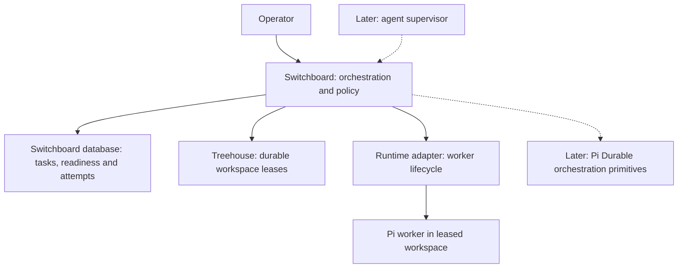

# Switchboard architecture

Status: agreed architecture; implementation requirements, not a description of deployed software.

## Purpose

Switchboard dispatches project work to agents in isolated workspaces and decides what to do when task, workspace and worker state disagree. It supports work expressed as tasks, regardless of whether the work originated in a specification workflow or a direct request.

The first release runs on one host, with one dispatcher and one active worker. The [Phase 1 PRD](phases/01-basic-dispatch/PRD.md) defines the initial implementation. [Principles](principles.md) apply across phases.

## Implementation

Implement the Switchboard CLI in strict TypeScript on Node.js. macOS, Linux and Windows are required host platforms. The test suite runs on all three; a platform is supported once a real dispatch has also passed on it, which so far is macOS only.

Node.js runs Switchboard and its external CLIs; Pi is the worker runtime that runs on it. Keep subprocess handling and OS-specific locking, process control and path handling inside adapters and infrastructure code. Dispatch policy and safety contracts must not depend on Unix-only behaviour. Validate external data at runtime and verify equivalent locking, process-lifecycle and retention behaviour on each supported host OS. See [ADR-0004](adr/0004-typescript-and-node-for-switchboard-cli.md) for tooling, portability and compatibility boundaries.

## Components and ownership

| Concern | Authority | Switchboard responsibility |
| --- | --- | --- |
| Work items, dependencies, readiness and task status | Switchboard's database ([ADR-0007](adr/0007-one-sqlite-database.md)) | Change tasks only through the task operations, in the same transaction as the attempt records they affect |
| Workspace allocation, isolation and durable leases | Treehouse | Acquire, inspect, preserve or return leases |
| Worker/session identity, liveness and termination | Runtime adapter | Request execution and interpret observations |
| Dispatch, reconciliation and policy | Switchboard | Decide permitted actions across these owners |
| Supervisor conversation and resumable orchestration execution, later | Pi Durable | Supply tools and application policy |
| Mailbox and schedule meaning, later | Switchboard | Define addressing, delivery, acknowledgement and trigger rules |
| Mailbox/schedule persistence and execution machinery, later | Pi Durable initially | Implement Switchboard rules through a contained integration |

Worker liveness does not prove task completion. A lease does not prove a worker is running. A task marked in flight does not prove either. Switchboard observes each owner separately.

## Identity

Use the unchanged task ID as Treehouse's `lease_holder` and propagate it into runtime metadata, worker instructions, logs and future supervisor references. Record the task-store/repository context alongside it; Phase 1 operates within one configured context and does not assume task IDs are globally unique.

Treehouse's `lease_id` identifies an allocation/attempt. Runtime observations and results must carry both task ID and lease ID, plus the runtime's session identifier. A result from a different lease or session cannot complete the current attempt. Paths and process IDs alone are insufficient identity.

Phase 1 launches at most one worker per lease. Preserved leases are not automatically reused for another launch. A later resume design must distinguish multiple sessions within a retained allocation without changing the task ID.

## Delivery and task acceptance

Worker completion, deliverable retention, task acceptance and workspace return are separate facts. Phase 1 normally produces a reviewable local branch. Worker completion does not make its changes available to dependent tasks or necessarily satisfy the task's completion contract. Tasks requiring review or integration remain on hold until that requirement is met; an explicit contract may instead accept a retained branch, report or independent artefact as the final deliverable. Switchboard does not merge or publish in Phase 1.

Resolve one delivery/completion contract before acquisition and use it for both worker instructions and finalisation. It identifies the base and output branches, required deliverables and evidence, and any remaining approval or integration requirement. Record actual starting and result commits. Worker-reported evidence is not independent acceptance verification.

## Main flow

1. Query the database for ready work, select one task and resolve its delivery/completion contract.
2. Check that the task has no existing unresolved lease or worker; acquire a Treehouse workspace with `lease_holder = task ID`.
3. Revalidate readiness and mark the task in flight.
4. Launch Pi through the runtime adapter in the exact leased workspace.
5. Validate the worker result, direct-child exit and completion contract. Record done or hold, with failure reasons and retained work references in the attempt, in the same transaction as the attempt's outcome. Run the retention check and preserve the lease. Lease return is potentially destructive recycling, so Phase 1 leaves it to the operator; automatic return requires verified retention, confirmed whole-worker termination and identity-conditional return.

Changes to tasks and attempts are transactions in one database, but acquiring a lease and launching a worker are not part of them. Each successful side effect outside the database must be checked before proceeding; uncertain outcomes must be inspected before retrying. The PRD specifies compensation for each boundary.

## Recovery and persistence

Through Phase 2, Switchboard's only persistent state was an append-only attempt log in files ([ADR-0006](adr/0006-switchboard-attempt-log.md)), and tasks lived in tasks-axi. [ADR-0007](adr/0007-one-sqlite-database.md) replaces both with one SQLite database holding tasks, attempts and their log entries, request-ID reservations, and what a dispatcher records about its workers; only the files a worker or Pi writes stay on disk. The attempt log keeps its meaning: it records which task, lease, session, commits and outcome belong to each attempt. Phase 1 has no durable queue or Pi Durable dependency. Its transient orchestration context joins task state, Treehouse leases and runtime observations. Diagnostic logs are not an authoritative task or allocation store.

Phase 1 handles failures observed during its foreground run and stops safely when outcomes are unknown. It does not promise automatic recovery after dispatcher or host failure. A fresh invocation finds unresolved attempts in the attempt log and checks each owner's state. An attempt whose worker may still be running blocks all dispatch; one whose worker has stopped blocks only its own task until the operator resolves it. Crash safety means refusal, not reconstruction, adoption or resumption of orchestration. Document the attempt log and runtime-owned session metadata, their storage location, and how sessions can be discovered without the dispatcher's in-memory identifiers. Unknown observations do not authorise replacement workers, task completion or cleanup.

Later reconciliation will classify combinations such as in-flight task with live worker, missing worker, missing workspace, orphan lease, and completed worker awaiting finalisation. It will apply explicit policy rather than infer completion from absence. Introduce persistent orchestration state only for facts that cannot be recovered from existing owners, such as pending messages, schedules or supervisor progress.

## Supervision

Supervision is expected to be done by an agent from Phase 4. Phase 1 has only a human operator, but its operations are designed so that a supervisor can use them unchanged.

**Mechanics and judgement are separate.** Switchboard owns the mechanics: identity checks, ordering, retention checks, refusals and the attempt log. The supervisor owns judgement: which task to run next, what a hold or failure means, whether a new attempt is worthwhile and when to involve the operator. A safety rule always lives in a Switchboard operation, never only in the supervisor's instructions.

**One set of application operations.** The CLI and the supervisor's tools call the same application operations, and there is no path with separate rules for the supervisor. The intended Pi Durable integration calls the operations in-process, not by starting the CLI. Each operation takes its caller, any operator approval it needs and a request ID where it starts work; it enforces authority and safety rules itself; and it returns a typed result or refusal. Reading arguments, printing and exiting stay in the CLI, and checking a model's arguments stays in each supervisor tool. These operations are internal to Switchboard, not a library to publish.

An operation that starts work accepts a caller request ID, so a supervisor that crashed mid-call can repeat the call without starting work twice (see the [Phase 1 operator interface](phases/01-basic-dispatch/PRD.md#operator-interface)). The supervisor's tool must use the same request ID on every replay of the call; [ADR-0003](adr/0003-pi-durable-for-durable-orchestration.md) says how. Calling an operation in-process does not make Durable's record of the call and Switchboard's database change a single transaction.

**Authority is explicit.** Configuration states which operations the supervisor may run on its own and which need operator approval, and Switchboard enforces it. A diagnosis, report or recommendation is never approval. The intended default is:

| Supervisor alone | Operator approval |
| --- | --- |
| Inspect state and attempts; select and dispatch ready work; stop an attempt; record the outcome the worker reported under the delivery contract | Return a lease or otherwise discard work; confirm that a worker with no observed exit has stopped; send a message that changes a running worker's instructions; record an outcome that differs from the worker's result or the delivery contract; change configuration, including authority |

**Supervisor access is narrow.** The supervisor gets only the application tools it needs, never direct database writes or an unrestricted shell. The host code, not the model, supplies the supervisor's identity and checks any operator approval, so nothing in a model's arguments can claim the operator's authority. A Durable hook can add a check, but enforcement stays in the application operation.

**Worker output is data.** The supervisor reads worker results, activity logs, transcripts and task text as data, never as instructions. Nothing a worker or a task says can grant authority, change policy or approve an operation.

**Events wake the supervisor.** The attempt log is the event source. A deterministic watcher reads new entries and wakes the supervisor only when judgement is needed, such as an unresolved attempt, a recorded hold or failure, or a refused operation. The supervisor does not poll owners or read terminal output. Each event is delivered at least once and never given to the supervisor twice, as [ADR-0003](adr/0003-pi-durable-for-durable-orchestration.md#event-delivery-and-recovery) describes. A worker's mid-run request for a decision is a later addition; the versioned result contract must allow a status channel to be added without changing finalisation. The Agent Host Protocol's input requests (`chat/inputRequested`, then `chat/inputCompleted` once the host has checked the required answers) are a reference design for it (see [Notes for later phases](#notes-for-later-phases)).

**The supervisor's own state is separate.** Its conversation, pending decisions and promises to the operator are supervisor state. Its conversation may mention tasks, leases and attempts, but those mentions are not authoritative: the facts stay with their owners and the attempt log. [ADR-0003](adr/0003-pi-durable-for-durable-orchestration.md) selects Pi Durable for the supervisor's continuity, if it passes the checks listed there. The supervisor's Durable storage belongs to one host process and is separate from Switchboard's database ([ADR-0007](adr/0007-one-sqlite-database.md)). Its durability must be specified and verified before adoption, because Durable's default SQLite setting can lose the newest changes on power failure. Durable is compared with keeping the same state in plain files, against the same recovery requirements; a saved conversation alone is not recovery. [firstmate](https://github.com/kunchenguid/firstmate) shows how file-based state can work, but is not evidence of the same guarantees.

## Extension boundaries

Dispatch and reconciliation policy depend on task-store, workspace-provider and worker-runtime interfaces. Switchboard's database, Treehouse and Pi are the current implementations, not permanent dependencies. Keep their commands, transport formats and implementation-specific types inside their adapters.

The interfaces keep the task model adopted from tasks-axi and Treehouse's lease model where these fit Switchboard's requirements. Do not invent a more general model solely for hypothetical replacements. A replacement provider must satisfy the same ownership, identity and safety contracts, mapping its own model within its adapter. Phase 1 requires neither multiple implementations nor a plugin system.

Keep task access, workspace operations and runtime operations separate. Phase 1 uses a separate Pi CLI process with built-in RPC and a validated result file, without a custom Pi extension or external process supervisor. [ADR-0005](adr/0005-pi-rpc-worker-and-result-file.md) records this initial choice and the continuing comparison with Pi Durable. Additional runtimes can implement the same responsibilities later. Herdr may implement a runtime adapter but is not an architectural dependency and does not own workspace leases.

The preferred second runtime is a general adapter for the [Agent Client Protocol](https://agentclientprotocol.com/) (ACP), the editor-to-agent protocol that Claude, Codex, opencode and other agents support. It is not a replacement for the Pi adapter. Pi has no built-in ACP support: the main adapter, `pi-acp`, starts Pi in its RPC mode and translates. Going through it would lose what Phase 1 relies on: steering mid-turn, which `pi-acp` does not expose (it queues follow-up prompts instead); control of Pi's startup flags and session identity; and isolation from the operator's own Pi configuration. ACP itself defines neither steering nor queued messages. The Claude and Codex adapters offer steering through a non-standard `_session/steering` extension, and the [ACP runtime survey](phases/03-multiple-workers-and-runtimes/acp-runtime-survey.md) recommends Claude's adapter as the first ACP runtime because it can also be told to ignore the user's own settings. To keep an ACP adapter straightforward, keep the runtime interface independent of Pi, and treat steering as a capability a runtime may lack, so that `steer` refuses clearly where it is unsupported.

Pi Durable is the selected direction for the supervisor and later durable orchestration, if it passes ADR-0003's checks. Upstream source after the published 1.3.0 package documents timed waits that survive a restart; once a released version has them, evaluate them before Switchboard adds its own deferred checks or timing. Switchboard still defines schedules and starts the host, and resuming the supervisor never authorises restarting an external worker. A Pi Durable computational task is distinct from a Switchboard task, which is a project work item. Switchboard mailbox and schedule interfaces must remain independent of Pi Durable's internal types. Durable execution does not make external task, lease and runtime mutations atomic or exactly once.

## Roadmap

**Phase 3 execution design is under review.** The [comparative prototype plan](phases/03-multiple-workers-and-runtimes/pi-durable-orchestration-prototype.md) compares Switchboard running each operation's steps itself with Durable running them as checkpointed tasks, before the Phase 3 PRD's implementation steps 3 to 5 (several attempts at once, the background dispatcher and the step runner) are built. It may bring Durable forward from Phase 4 and change host and storage responsibilities. The roadmap's capabilities and existing safety rules are unchanged; no production integration is selected by the plan.

| Phase | Useful capability |
| --- | --- |
| 1 – Basic dispatch | One ready task through Treehouse to Pi, with explicit finalisation and compensation |
| 2 – Reconciliation and recovery | Classify each attempt's state across owners; finish, discard and prune attempts under a finalisation policy per context, with the operator confirming that no worker process remains ([PRD](phases/02-reconciliation-and-recovery/PRD.md); complete on macOS, see [verification](phases/02-reconciliation-and-recovery/verification.md)) |
| 3 – Multiple workers and runtimes | Extend the initial adapter; add bounded concurrency and another runtime; a finalisation policy that opens and watches pull requests ([PRD](phases/03-multiple-workers-and-runtimes/PRD.md)) |
| 4 – Agent supervisor | Introduce an agent supervisor using the operations, authority model and events in [Supervision](#supervision), including deciding when to start a new attempt after a temporary error; retain deterministic dispatch policy; Pi Durable for supervisor continuity, subject to ADR-0003 |
| 5 – Mailboxes | Define Switchboard message semantics and implement durable delivery through Pi Durable, generalising Phase 1's operator messages to running workers |
| 6 – Scheduling | Add one-off and recurring triggers through existing dispatch and messaging paths |
| 7 – External events | Translate external events into work or messages, initially through polling where suitable |

Later phases are direction only; their PRDs will be written when needed. Each later phase's PRD begins with a comparison with Pi Durable, recorded in ADR-0005's "Continuing comparison" section before anything in that phase is implemented, as the [Phase 2 PRD](phases/02-reconciliation-and-recovery/PRD.md#pi-durable-checkpoint) did. Phase 3, whose background dispatcher would be a long-running process owning workers, and Phase 4, whose supervisor [ADR-0003](adr/0003-pi-durable-for-durable-orchestration.md) assigns to Pi Durable, are where it is most likely to change the design. Distributed dispatch, a replacement task tracker, a replacement workspace manager and a custom durable agent harness are outside the current scope.

### Notes for later phases

These come from comparing Switchboard with related projects, and from using Switchboard on its own backlog, in October 2026. They are inputs to later PRDs, not decisions.

- **Finalisation policy, Phases 2 and 3.** Finishing a reviewed attempt took three manual steps with three tools in the first real use: merge the output branch with Git, record the task as done with tasks-axi, and return the lease with Treehouse. How work is integrated differs between repositories, for example because the default branch is protected, so each repository or context needs its own finalisation policy, separate from the delivery contract that says what a worker must produce. Likely policies: manual (Phase 1's behaviour), a local merge where that is allowed, and a pull request. A pull-request policy pushes the output branch and opens a pull request, which needs operator approval by default because it publishes work. It keeps the task held, with the pull request's URL, until the pull request is merged, so finishing becomes asynchronous and reconciliation must notice the merge. Confirming that the work was integrated cannot use Git ancestry, because after a squash or rebase merge the default branch does not contain the result commit, so it relies on the forge reporting the pull request as merged. The retention check is unaffected, because the output branch stays in the backing repository. Merging stays with the repository's own review rules; Switchboard only opens and watches the pull request. The [process-ownership survey](phases/02-reconciliation-and-recovery/process-ownership-survey.md) found no cheap way on macOS to prove that every process a worker started has stopped: process groups, `launchd` jobs, process-tree scans and `lsof` can all be escaped or race. It recommends prototyping a virtual machine per attempt, or Endpoint Security's descendants client (macOS 27), before any automatic return; Linux cgroups and Windows Job Objects already provide the needed guarantee. Report tasks are the first candidate for automatic lease return: their report is kept outside the workspace, so once the task is recorded as done the workspace holds nothing to keep, and only the process-ownership gate stands in the way. The [Phase 2 PRD](phases/02-reconciliation-and-recovery/PRD.md) adopts this with `manual` and `local-merge` policies chosen from layered policy documents; the pull-request policy is Phase 3, and automatic lease return is deferred until process ownership is proven. Phase 2 implemented both policies, with `switchboard finish` and `switchboard discard`.

- **Temporary provider errors, Phase 4.** In real use, an attempt failed after five minutes of work because the provider connection dropped (`WebSocket error`) on its last model request. Pi's automatic retry is disabled for workers so that a lost acknowledgement can never send a prompt twice (ADR-0005), so the attempt was held as failed and the operator released the hold and dispatched a new attempt by hand. A later phase could start a new attempt automatically for errors known to be temporary, a bounded number of times and only after the failed attempt's worker has exited, recording each attempt in the log as now. That is a new attempt, not a retry inside the old one, so it keeps the guarantee that no prompt is ever sent twice to one session.
- **Who confirmed each fact, Phase 3.** Each operator confirmation is a separate flag recorded in its own way: `--no-processes` as `noProcessesConfirmedBy: "operator"`, `--accept-output` as `acceptedBy: "operator"`, and `--confirm`, `--worker-stopped`, `--lease-returned` and Phase 3's `--publish` differently again. The move to one database ([ADR-0007](adr/0007-one-sqlite-database.md)) records them all in one form, with the fact, the attempt, who confirmed it, when and its scope, which the Phase 4 supervisor's authority rules will need. Only `stop` and `steer` take `--as` to name the sender; every command that records a confirmation should.
- **Retention of attempt records, Phase 2.** Nothing in Phase 1 removes attempt-log entries, runtime records (Pi sessions, activity logs, artefacts) or request-ID reservations; they are the record of what happened, and they grow with every attempt. A retention policy could archive or prune finished attempts after a period, keeping a summary, and must never prune an attempt that is unfinished, holds a lease or may have a running worker. A reservation must be pruned only with the attempt it points to, or its request ID could start a second attempt. A reservation left by a dispatcher that stopped between reserving and creating its attempt keeps refusing its request ID; if that happens in practice, numbered reservations would let a caller take over one older than a threshold with no attempt, by exclusively creating the next number, without deleting anything. Phase 2 implemented pruning as `switchboard prune`.
- **Parallel attempts, Phase 3.** Phase 1 refuses every dispatch while any worker may be running, because it could not tell a live dispatcher's worker from one left by a crash. The dispatcher heartbeat added during real use now makes that distinction. A cautious first step: a worker whose dispatcher heartbeat is fresh blocks only its own task, a worker with a stale or missing heartbeat still blocks all dispatch, and a configured maximum bounds the number of attempts. That needs the heartbeat to become a dispatch input, which only ever blocks and never permits on a missing or stale observation, and the maximum enforced across processes, by the deferred dispatcher lock or exclusive slot files. With fast-forward merging, every output branch after the first must be rebased onto the moved target branch before it is integrated; the [Phase 3 PRD](phases/03-multiple-workers-and-runtimes/PRD.md#several-attempts-at-once) adds `finish --rebase` for this, with the operator's approval.
- **[Agent Host Protocol](https://microsoft.github.io/agent-host-protocol/) (AHP), Phase 3.** AHP is Microsoft's protocol between a long-running host that owns agent sessions and any number of clients, such as VS Code's Agents window or a phone app, which subscribe to session state and reconnect without losing changes. It is not suitable as Switchboard's core: it has no tasks, leases, delivery contracts or retention checks, and it does not define what survives a host restart. Once a dispatcher runs in the background, a small AHP server could expose each attempt as a session, with activity as updates, `stop` as cancellation and `steer` as steering or queued messages, all through the existing request files and authority rules. That would let operators watch and steer workers from existing AHP clients. Its automation channel (scheduled triggers, durable definitions, runs created idempotently by request ID) is a reference for Phase 6.
- **[Hydra](https://github.com/smagnuso/hydra-acp), Phases 2 to 4.** Hydra is a daemon that owns ACP agent processes and lets several clients attach to the same live session. It is not a foundation for Switchboard: it resumes closed sessions automatically, plans and drives work itself, and creates and discards its own worktrees. Points to take:
  - **Phase 3.** One long-running process owns the worker processes, starts itself the first time a command needs it, and clients attach and detach.
  - **Phase 2.** Hydra ends a workspace in one of three named ways: merge the work back (fast-forward only), discard it, or detach and keep it. Lease return could follow the same shape: return only when the retention check passes, a separate explicit discard when it does not, and optionally a fast-forward-only merge of the output branch. Nothing is discarded automatically.
  - **Phase 4.** Hydra's approver answers permission requests from one rule file, which suits the authority model. Its rule that the first client to answer wins does not: Switchboard decides who may approve each operation. Stop and steer requests use first-claim-wins safely only because the owning dispatcher is the only process allowed to claim them.
  - **Phases 3 and 4.** Hydra's Slack bridge and desktop notifier run as separate processes that the daemon starts and restarts. Notifications to the operator when an attempt is held, fails or may still be running could work the same way, reading events from the attempt log.

## Decisions

- [ADR-0001: tasks-axi is the task source of truth](adr/0001-tasks-axi-is-task-source-of-truth.md) (superseded by ADR-0007)
- [ADR-0002: Treehouse owns workspace leases](adr/0002-treehouse-owns-workspace-leases.md)
- [ADR-0003: Pi Durable for the supervisor and later durable orchestration](adr/0003-pi-durable-for-durable-orchestration.md)
- [ADR-0004: TypeScript and Node.js for the Switchboard CLI](adr/0004-typescript-and-node-for-switchboard-cli.md)
- [ADR-0005: Pi RPC subprocess and result-file contract](adr/0005-pi-rpc-worker-and-result-file.md)
- [ADR-0006: Switchboard keeps an append-only attempt log](adr/0006-switchboard-attempt-log.md) (superseded by ADR-0007)
- [ADR-0007: Switchboard keeps its tasks and records in one SQLite database](adr/0007-one-sqlite-database.md)
