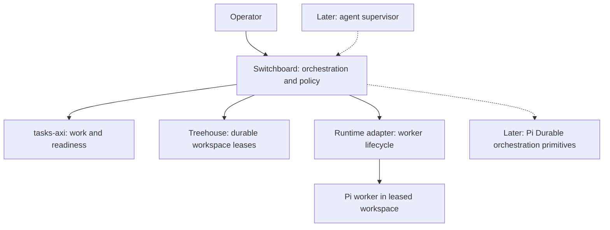

# Switchboard architecture

Status: agreed architecture; implementation requirements, not a description of deployed software.

## Purpose

Switchboard dispatches project work to agents in isolated workspaces and decides what to do when task, workspace and worker state disagree. It supports work expressed as tasks, regardless of whether the work originated in a specification workflow or a direct request.

The first release runs on one host, with one dispatcher and one active worker. The [Phase 1 PRD](phases/01-basic-dispatch/PRD.md) defines the initial implementation. [Principles](principles.md) apply across phases.

## Implementation

Implement the Switchboard CLI in strict TypeScript on Node.js. macOS, Linux and Windows are required host platforms for Switchboard; Phase 1 initially supports macOS only. Linux and Windows support is deferred, not optional. Support is verified separately on each native host before it is advertised.

Node.js runs Switchboard and its external CLIs; Pi is the worker runtime that runs on it. Keep subprocess handling and OS-specific locking, process control and path handling inside adapters and infrastructure code. Dispatch policy and safety contracts must not depend on Unix-only behaviour. Validate external data at runtime and verify equivalent locking, process-lifecycle and retention behaviour on each supported host OS. See [ADR-0004](adr/0004-typescript-and-node-for-switchboard-cli.md) for tooling, portability and compatibility boundaries.

## Components and ownership

| Concern | Authority | Switchboard responsibility |
| --- | --- | --- |
| Work items, dependencies, readiness and task status | tasks-axi | Query and apply supported transitions |
| Workspace allocation, isolation and durable leases | Treehouse | Acquire, inspect, preserve or return leases |
| Worker/session identity, liveness and termination | Runtime adapter | Request execution and interpret observations |
| Dispatch, reconciliation and policy | Switchboard | Decide permitted actions across these owners |
| Supervisor conversation and resumable orchestration execution, later | Pi Durable | Supply tools and application policy |
| Mailbox and schedule meaning, later | Switchboard | Define addressing, delivery, acknowledgement and trigger rules |
| Mailbox/schedule persistence and execution machinery, later | Pi Durable initially | Implement Switchboard rules through a contained integration |

Worker liveness does not prove task completion. A lease does not prove a worker is running. A task marked in flight does not prove either. Switchboard observes each owner separately.

## Identity

Use the unchanged tasks-axi task ID as Treehouse's `lease_holder` and propagate it into runtime metadata, worker instructions, logs and future supervisor references. Record the task-store/repository context alongside it; Phase 1 operates within one configured context and does not assume task IDs are globally unique.

Treehouse's `lease_id` identifies an allocation/attempt. Runtime observations and results must carry both task ID and lease ID, plus the runtime's session identifier. A result from a different lease or session cannot complete the current attempt. Paths and process IDs alone are insufficient identity.

Phase 1 launches at most one worker per lease. Preserved leases are not automatically reused for another launch. A later resume design must distinguish multiple sessions within a retained allocation without changing the task ID.

## Delivery and task acceptance

Worker completion, deliverable retention, task acceptance and workspace return are separate facts. Phase 1 normally produces a reviewable local branch. Worker completion does not make its changes available to dependent tasks or necessarily satisfy the task's completion contract. Tasks requiring review or integration remain on hold until that requirement is met; an explicit contract may instead accept a retained branch, report or independent artefact as the final deliverable. Switchboard does not merge or publish in Phase 1.

Resolve one delivery/completion contract before acquisition and use it for both worker instructions and finalisation. It identifies the base and output branches, required deliverables and evidence, and any remaining approval or integration requirement. Record actual starting and result commits. Worker-reported evidence is not independent acceptance verification.

## Main flow

1. Query the explicitly configured authoritative tasks-axi store for ready work, select one task and resolve its delivery/completion contract.
2. Check that the task has no existing unresolved lease or worker; acquire a Treehouse workspace with `lease_holder = task ID`.
3. Revalidate readiness and mark the task in flight through tasks-axi.
4. Launch Pi through the runtime adapter in the exact leased workspace.
5. Validate the worker result, direct-child exit and completion contract. Record done or hold, including failure reasons and retained work references, through tasks-axi. Run the retention check and preserve the lease. Lease return is potentially destructive recycling, so Phase 1 leaves it to the operator; automatic return requires verified retention, confirmed whole-worker termination and identity-conditional return.

These operations are not one transaction. Each successful side effect must be checked before proceeding; uncertain outcomes must be inspected before retrying. The PRD specifies compensation for each boundary.

## Recovery and persistence

Phase 1's only persistent Switchboard state is an append-only attempt log ([ADR-0006](adr/0006-switchboard-attempt-log.md)). It records which task, lease, session, commits and outcome belong to each attempt, and is not authoritative for any of them. Phase 1 has no durable queue or Pi Durable dependency. Its transient orchestration context joins task state, Treehouse leases and runtime observations. Diagnostic logs are not an authoritative task or allocation store.

Phase 1 handles failures observed during its foreground run and stops safely when outcomes are unknown. It does not promise automatic recovery after dispatcher or host failure. A fresh invocation finds unresolved attempts in the attempt log and checks each owner's state. An attempt whose worker may still be running blocks all dispatch; one whose worker has stopped blocks only its own task until the operator resolves it. Crash safety means refusal, not reconstruction, adoption or resumption of orchestration. Document the attempt log and runtime-owned session metadata, their storage location, and how sessions can be discovered without the dispatcher's in-memory identifiers. Unknown observations do not authorise replacement workers, task completion or cleanup.

Later reconciliation will classify combinations such as in-flight task with live worker, missing worker, missing workspace, orphan lease, and completed worker awaiting finalisation. It will apply explicit policy rather than infer completion from absence. Introduce persistent orchestration state only for facts that cannot be recovered from existing owners, such as pending messages, schedules or supervisor progress.

## Supervision

Supervision is expected to be done by an agent from Phase 4. Phase 1 has only a human operator, but its operations are designed so that a supervisor can use them unchanged.

**Mechanics and judgement are separate.** Switchboard owns the mechanics: identity checks, ordering, retention checks, refusals and the attempt log. The supervisor owns judgement: which task to run next, what a hold or failure means, whether a new attempt is worthwhile and when to involve the operator. A safety rule always lives in a Switchboard operation, never only in the supervisor's instructions.

**One set of operations.** The supervisor and the operator use the same operations through the same structured interface. There is no supervisor-only path. Each operation enforces its own safety rules whoever calls it, and returns machine-readable results and refusals. An operation that starts work accepts a caller request ID, so a supervisor that crashed mid-call can repeat the call without starting work twice (see the [Phase 1 operator interface](phases/01-basic-dispatch/PRD.md#operator-interface)).

**Authority is explicit.** Configuration states which operations the supervisor may run on its own and which need operator approval, and Switchboard enforces it. A diagnosis, report or recommendation is never approval. The intended default is:

| Supervisor alone | Operator approval |
| --- | --- |
| Inspect state and attempts; select and dispatch ready work; stop an attempt; record the outcome the worker reported under the delivery contract | Return a lease or otherwise discard work; confirm that a worker with no observed exit has stopped; record an outcome that differs from the worker's result or the delivery contract; change configuration, including authority |

**Events wake the supervisor.** The attempt log is the event source. A deterministic watcher reads new entries and wakes the supervisor only when judgement is needed, such as an unresolved attempt, a recorded hold or failure, or a refused operation. The supervisor does not poll owners or read terminal output. A worker's mid-run request for a decision is a later addition; the versioned result contract must allow a status channel to be added without changing finalisation.

**The supervisor's own state is separate.** Its conversation, pending decisions and promises to the operator are supervisor state. It never holds task, lease or attempt facts, which stay with their owners and the attempt log. [ADR-0003](adr/0003-pi-durable-for-durable-orchestration.md) selects Pi Durable for supervisor continuity, with the supervisor as a Pi Durable conversation whose tools call Switchboard's operations; at integration time, compare it with keeping that state in plain files, which is how [firstmate](https://github.com/kunchenguid/firstmate) makes a restart lose nothing.

## Extension boundaries

Dispatch and reconciliation policy depend on task-store, workspace-provider and worker-runtime interfaces. tasks-axi, Treehouse and Pi are the initial implementations, not permanent dependencies. Keep their commands, transport formats and implementation-specific types inside their adapters.

The initial interfaces may adopt tasks-axi's task model and Treehouse's lease model where these fit Switchboard's requirements. Do not invent a more general model solely for hypothetical replacements. A replacement provider must satisfy the same ownership, identity and safety contracts, mapping its own model within its adapter. Phase 1 requires neither multiple implementations nor a plugin system.

Keep task access, workspace operations and runtime operations separate. Phase 1 uses a separate Pi CLI process with built-in RPC and a validated result file, without a custom Pi extension or external process supervisor. [ADR-0005](adr/0005-pi-rpc-worker-and-result-file.md) records this initial choice and the continuing comparison with Pi Durable. Whole-worker termination still requires process-ownership verification; direct-child exit is insufficient. Phase 1 finalises on direct-child exit and therefore never returns leases automatically. Additional runtimes can implement the same responsibilities later. Herdr may implement a runtime adapter but is not an architectural dependency and does not own workspace leases.

Pi Durable will support the supervisor and durable orchestration. A Pi Durable computational task is distinct from a tasks-axi work item. Switchboard mailbox and schedule interfaces must remain independent of Pi Durable's internal types. Durable execution does not make external task, lease and runtime mutations atomic or exactly once.

## Roadmap

| Phase | Useful capability |
| --- | --- |
| 1 — Basic dispatch | One ready task through Treehouse to Pi, with explicit finalisation and compensation |
| 2 — Reconciliation and recovery | Inspect disagreements across owners; define safe restart and repair actions; automatic lease return once process ownership is verified |
| 3 — Multiple workers and runtimes | Extend the initial adapter; add bounded concurrency and another runtime |
| 4 — Agent supervisor | Introduce an agent supervisor using the operations, authority model and events in [Supervision](#supervision); retain deterministic dispatch policy; Pi Durable for supervisor continuity, subject to ADR-0003 |
| 5 — Mailboxes | Define Switchboard message semantics and implement durable delivery through Pi Durable |
| 6 — Scheduling | Add one-off and recurring triggers through existing dispatch and messaging paths |
| 7 — External events | Translate external events into work or messages, initially through polling where suitable |

Later phases are direction only; their PRDs will be written when needed. Distributed dispatch, a replacement task tracker, a replacement workspace manager and a custom durable agent harness are outside the current scope.

## Decisions

- [ADR-0001: tasks-axi is the task source of truth](adr/0001-tasks-axi-is-task-source-of-truth.md)
- [ADR-0002: Treehouse owns workspace leases](adr/0002-treehouse-owns-workspace-leases.md)
- [ADR-0003: Pi Durable for the supervisor and later durable orchestration](adr/0003-pi-durable-for-durable-orchestration.md)
- [ADR-0004: TypeScript and Node.js for the Switchboard CLI](adr/0004-typescript-and-node-for-switchboard-cli.md)
- [ADR-0005: Pi RPC subprocess and result-file contract](adr/0005-pi-rpc-worker-and-result-file.md)
- [ADR-0006: Switchboard keeps an append-only attempt log](adr/0006-switchboard-attempt-log.md)
